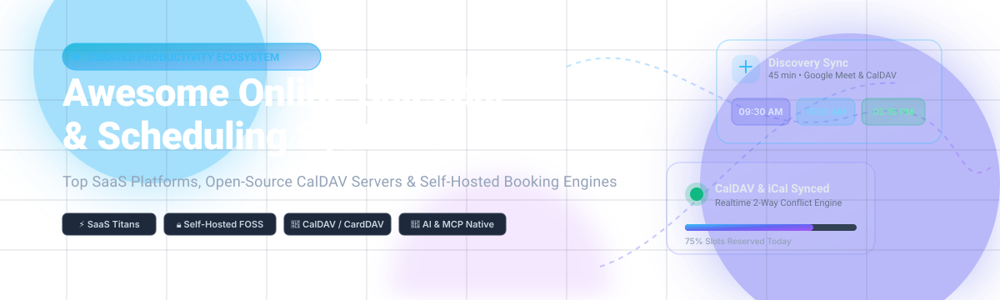

# 🗓️ Awesome Online Calendar & Scheduling

**A curated index of top Online Calendar software, appointment scheduling tools, booking infrastructure, and self-hosted open-source CalDAV/iCal servers.**

*Discover enterprise SaaS platforms, privacy-respecting self-hosted alternatives to Calendly, CalDAV synchronization engines, and AI-enabled scheduling protocols.*

---

[🌐 Sector Overview](#-sector-overview--market-dynamics) • [🟦 SaaS Platforms](#-saas--hosted-platforms) • [🟩 Open-Source Software](#-open-source-software) • [📊 Comparison](#-comparison-at-a-glance) • [🤝 Contributing](#-contributing)

---

## 📑 Table of Contents

- [🌐 Sector Overview & Market Dynamics](#-sector-overview--market-dynamics)
- [🟦 SaaS / Hosted Platforms](#-saas--hosted-platforms)
- [🟩 Open-Source Software](#-open-source-software)
- [📊 Comparison at a Glance](#-comparison-at-a-glance)
- [🤝 Contributing](#-contributing)
- [💖 Support](#-support)
- [⭐ Star History](#-star-history)
- [📄 License](#-license)

---

## 🌐 Sector Overview & Market Dynamics

The global appointment scheduling and calendar software market was valued at approximately **$550 million to $640 million** and is compounding at a **CAGR of ~13% to 15%**, projected to eclipse **$1.8 billion to $2.5 billion** over the next decade. The sector is **moderately to highly fragmented** rather than winner-take-all: while mega-ecosystem incumbents (Google Workspace, Microsoft 365) and horizontal leaders (Calendly) dominate generic bookings, intense fragmentation persists due to vertical-specific demands across healthcare (HIPAA compliance), salon/service appointments, high-security enterprise workflows, and developer-centric open-source protocols.

---

## 🟦 SaaS / Hosted Platforms

Commercial, cloud-hosted online calendar and automated booking services. Platforms are sorted in descending order by parent company scale (market valuation / enterprise capitalization).

| 🏢 Platform | 💰 Company Valuation / Revenue | 🏷️ Entry Tier Pricing | 🎁 Free Tier Limits / Trial Constraints | 🎯 Primary Architecture & Best For |
|:---|:---|:---|:---|:---|
| **[Apple Calendar](https://www.apple.com/macos/continuity/)** | **~$3.5 Trillion Market Cap** (Apple Inc. FY24 Revenue: ~$391B) | **Free** ($0.00 bundled with Apple hardware OS) | **Free forever without subscriptions.** Hard technical account caps: maximum 50,000 total items (events/reminders combined), 100 calendars, 1 GB calendar data size limit, 20 MB max per event, and up to 300 attendees per event across 5 GB base iCloud storage pool. | Native macOS, iOS, iPadOS, and watchOS calendar client with built-in CalDAV synchronization and iCloud multi-device backup. |
| **[Microsoft Outlook Calendar](https://www.microsoft.com/microsoft-365/outlook/calendar)** | **~$3.1 Trillion Market Cap** (Microsoft Corp. FY24 Revenue: ~$245B) | **$6.00 / user / month** (Microsoft 365 Business Basic, annual commitment) | **No standalone free-forever tier for Bookings.** Outlook web mail is free for personal use, but Microsoft Bookings appointment scheduling requires an active paid Microsoft 365 Business/Enterprise license; free trial available for 30 days (up to 25 business licenses). | Enterprise appointment scheduling deeply coupled to Microsoft Exchange, Azure AD/Entra ID, and Teams video conferencing. |
| **[Google Calendar](https://calendar.google.com/)** | **~$2.1 Trillion Market Cap** (Alphabet Inc. FY24 Revenue: ~$350B) | **$6.00 / user / month** (Google Workspace Business Starter, annual) | **Free forever with strict limit:** exactly 1 active public booking page/schedule. Free tier excludes automated SMS/email reminders, cannot collect Stripe payments, and only verifies conflicts against a single primary calendar. | Universal collaborative cloud calendar with lightweight booking links, native Google Meet rooms, and Gmail deep integration. |
| **[Calendly](https://calendly.com/)** | **$3.0 Billion Valuation** (Est. Annual Revenue: ~$350M ARR) | **$10.00 / seat / month** (Standard plan billed annually, or $12 monthly) | **Free forever with strict limit:** exactly 1 active event type, 1 calendar connection, and 1-on-1 meetings only. Free tier excludes automated reminders/workflows, Stripe/PayPal payment routing, team round-robin, and Calendly branding removal. | Standard self-service meeting scheduling platform with automated guest booking links and extensive third-party integrations. |
| **[Fantastical](https://flexibits.com/fantastical)** | **Bootstrapped Indie / Niche SaaS** (Est. ~$2M - $5M ARR) | **$4.75 / month** (Flexibits Premium individual plan billed annually at $56.99/yr, or $6.99 monthly) | **14-day full-featured free trial** converting to paid plan unless cancelled 24h prior. Reverts to free forever tier: includes basic calendar views, 3-day weather, and natural language entry, but strictly locks scheduling links (*Openings*), meeting polls (*Proposals*), and Zoom/Teams auto-generation behind Premium. | Premium Apple/macOS/iOS calendar client featuring natural language event parsing, time-zone widgets, and unified contact integration. |

---

## 🟩 Open-Source Software

Self-hostable calendar servers, meeting scheduling platforms, CalDAV gateways, and client applications. Repositories are sorted in descending order by GitHub stargazer count.

### 🌟 [Cal.com](https://cal.com/) 
- **Repository:** [calcom/cal.com](https://github.com/calcom/cal.com)
- **Tech Stack:** TypeScript / Next.js / PostgreSQL / Prisma / Tailwind CSS
- **License:** AGPLv3 (Open-Core)
- **Description:** The most popular open-source Calendly alternative. Features advanced booking pages, team round-robin scheduling, multi-calendar conflict detection, workflows, Web3/crypto payments, and native app integrations (Zoom, Google Meet, Slack). Available as a single-tenant self-hosted Docker deployment or managed SaaS cloud.

### 🌟 [FullCalendar](https://fullcalendar.io/) 
- **Repository:** [fullcalendar/fullcalendar](https://github.com/fullcalendar/fullcalendar)
- **Tech Stack:** TypeScript / JavaScript (React, Vue, Angular connectors)
- **License:** MIT (Standard) / Commercial (Premium plugins)
- **Description:** The undisputed standard drag-and-drop JavaScript calendar grid component for web applications. Provides day, week, month, timeline, and resource scheduling views with comprehensive timezone handling and iCalendar/gCal feeds.

### 🌟 [Stalwart All-in-One Mail & Calendar Server](https://stalwartlabs.com/) 
- **Repository:** [stalwartlabs/stalwart](https://github.com/stalwartlabs/stalwart)
- **Tech Stack:** Rust / RocksDB / SQLite / PostgreSQL / S3
- **License:** AGPL-3.0
- **Description:** Next-generation secure all-in-one enterprise collaboration server written in pure Rust. Native implementation of JMAP, IMAP4, SMTP, and full CalDAV/CardDAV calendar and contact management with high concurrency and negligible memory footprint.

### 🌟 [TOAST UI Calendar](https://ui.toast.com/tui-calendar) 
- **Repository:** [nhn/tui.calendar](https://github.com/nhn/tui.calendar)
- **Tech Stack:** JavaScript / TypeScript
- **License:** MIT
- **Description:** A polished, feature-packed client-side JavaScript calendar component providing daily, weekly, monthly, and task milestone views with drag-and-drop event resizing and customized themes.

### 🌟 [Planify](https://github.com/alainm23/planify) 
- **Repository:** [alainm23/planify](https://github.com/alainm23/planify)
- **Tech Stack:** Vala / GTK 4 / Libadwaita (Linux / GNOME)
- **License:** GPL-3.0
- **Description:** Elegant task and calendar planner designed for the GNOME desktop. Offers native two-way synchronization with Nextcloud, Todoist, and standard CalDAV calendar endpoints.

### 🌟 [MeetingBar](https://meetingbar.app/) 
- **Repository:** [leits/MeetingBar](https://github.com/leits/MeetingBar)
- **Tech Stack:** Swift / macOS Menu Bar
- **License:** Apache-2.0
- **Description:** Open-source macOS menu bar application providing instant access to upcoming meetings. Integrates directly with macOS Calendar accounts (Google, Outlook, CalDAV) and enables 1-click joining for 40+ video meeting providers (Zoom, Meet, Teams, Jitsi).

### 🌟 [Rallly](https://rallly.co/) 
- **Repository:** [lukevella/rallly](https://github.com/lukevella/rallly)
- **Tech Stack:** TypeScript / Next.js / Prisma / PostgreSQL / Tailwind CSS
- **License:** AGPL-3.0
- **Description:** Open-source group meeting poll and scheduling application (clean self-hostable alternative to Doodle). Lets teams vote on dates and times for meetings without mandatory attendee account sign-ups.

### 🌟 [Radicale](https://radicale.org/) 
- **Repository:** [Kozea/Radicale](https://github.com/Kozea/Radicale)
- **Tech Stack:** Python
- **License:** GPL-3.0
- **Description:** Lightweight, dependency-free CalDAV (calendar) and CardDAV (contact) server. Stores calendar events and tasks directly on the filesystem as standard iCalendar files. Ideal for personal servers, Raspberry Pis, and low-resource VPS nodes.

### 🌟 [Easy!Appointments](https://easyappointments.org/) 
- **Repository:** [alextselegidis/easyappointments](https://github.com/alextselegidis/easyappointments)
- **Tech Stack:** PHP / CodeIgniter / MySQL / jQuery
- **License:** GPL-3.0
- **Description:** Battle-tested self-hosted appointment scheduling engine. Designed for companies, medical practices, and freelancers to allow clients to book appointments via web interface. Supports Google Calendar synchronization and automated email notifications.

### 🌟 [Baïkal](https://sabre.io/baikal/) 
- **Repository:** [sabre-io/Baikal](https://github.com/sabre-io/Baikal)
- **Tech Stack:** PHP / sabre/dav / SQLite / MySQL
- **License:** GPL-3.0
- **Description:** Clean, lightweight CalDAV and CardDAV synchronization server powered by `sabre/dav`. Provides a friendly web-based administration dashboard to manage users, address books, and calendars.

### 🌟 [DAVx⁵ (OSE)](https://www.davx5.com/) 
- **Repository:** [bitfireAT/davx5-ose](https://github.com/bitfireAT/davx5-ose)
- **Tech Stack:** Kotlin / Android Native
- **License:** GPL-3.0
- **Description:** The standard open-source CalDAV/CardDAV synchronization client for Android. Delivers seamless two-way background sync between Android native calendar/contact providers and self-hosted servers (Nextcloud, Radicale, Baïkal, SOGo).

### 🌟 [SOGo Groupware](https://sogo.nu/) 
- **Repository:** [Alinto/sogo](https://github.com/Alinto/sogo)
- **Tech Stack:** Objective-C / C / WebDAV / MySQL / PostgreSQL
- **License:** GPL-2.0 / LGPL-2.0
- **Description:** Full-featured open-source groupware suite providing rich webmail, calendar sharing, resource reservation, and native CalDAV/CardDAV/ActiveSync synchronization for Microsoft Outlook and mobile devices.

### 🌟 [Nextcloud Calendar](https://apps.nextcloud.com/apps/calendar) 
- **Repository:** [nextcloud/calendar](https://github.com/nextcloud/calendar)
- **Tech Stack:** Vue.js / PHP / sabre/dav
- **License:** AGPL-3.0
- **Description:** The official calendar application for Nextcloud. Features appointment booking pages, resource reservation, room booking, CalDAV endpoints, attendee invitation management, and cross-organization calendar federation.

### 🌟 [Outlook CalDav Synchronizer](https://caldavsynchronizer.org/) 
- **Repository:** [aluxnimm/outlookcaldavsynchronizer](https://github.com/aluxnimm/outlookcaldavsynchronizer)
- **Tech Stack:** C# / .NET / VSTO Outlook Add-In
- **License:** AGPL-3.0
- **Description:** Free and open-source Outlook add-in that synchronizes events, tasks, and contacts between Microsoft Outlook desktop (2016-2024/M365) and any CalDAV/CardDAV server (Nextcloud, Radicale, SOGo, Google).

### 🌟 [Someday](https://someday-demo.vercel.app) 
- **Repository:** [rbbydotdev/someday](https://github.com/rbbydotdev/someday)
- **Tech Stack:** TypeScript / React / Shadcn UI / Vite / Google Apps Script
- **License:** MIT
- **Description:** Free-to-host calendar availability picker and Calendly alternative designed for Gmail and Google Apps Script users. Serverless architecture running without monthly server costs.

### 🌟 [Calrs](https://cal.rs/) 
- **Repository:** [olivierlambert/calrs](https://github.com/olivierlambert/calrs)
- **Tech Stack:** Rust / Axum / WebAssembly
- **License:** Open Source
- **Description:** Ultra-fast, self-hostable scheduling platform written in Rust. Features round-robin and collective team scheduling modes, tokenized private invite links, CalDAV calendar sync, and OIDC/Keycloak SSO authentication.

### 🌟 [Tymeslot](https://tymeslot.app) 
- **Repository:** [Tymeslot/tymeslot](https://github.com/Tymeslot/tymeslot)
- **Tech Stack:** Elixir / Phoenix LiveView / PostgreSQL / Docker
- **License:** AGPL-3.0
- **Description:** Modern, self-hostable alternative to Calendly built with Elixir. Features 4 customizable booking themes, two-way sync across Google, Outlook, iCloud, and CalDAV, automatic video rooms (Zoom, Google Meet, Jitsi, Nextcloud Talk), signed webhooks, and zero-fee Stripe Connect bookings.

### 🌟 [OpenReception](https://open-reception.org/) 
- **Repository:** [open-reception/appointment-booking-software](https://github.com/open-reception/appointment-booking-software)
- **Tech Stack:** TypeScript / Node.js / Docker
- **License:** AGPL-3.0
- **Description:** Privacy-first, end-to-end encrypted appointment scheduling platform designed specifically for medical practices, healthcare clinics, and public institutions. Developed with support from the German Prototype Fund.

### 🌟 [Calnode](https://calnode.com) 
- **Repository:** [Calnode/calnode](https://github.com/Calnode/calnode)
- **Tech Stack:** Go / SQLite / Single Binary
- **License:** Apache-2.0
- **Description:** Lean, single-binary scheduling engine with compiled-in Model Context Protocol (MCP) server. Enables autonomous AI agents to check slots and book meetings deterministically alongside web-based human booking pages.

### 🌟 [Tidetime](https://github.com/Sulaiman-Dauda/Tidetime) 
- **Repository:** [Sulaiman-Dauda/Tidetime](https://github.com/Sulaiman-Dauda/Tidetime)
- **Tech Stack:** Next.js / React / TypeScript / PostgreSQL / Drizzle
- **License:** Open Source
- **Description:** Multi-provider company booking system. Allows customers to book specific staff or automatically distributes bookings to the least-busy available team member with transactional double-booking prevention.

### 🌟 [JustBookMyCal](https://github.com/mxmehl/just-book-my-cal) 
- **Repository:** [mxmehl/just-book-my-cal](https://github.com/mxmehl/just-book-my-cal)
- **Tech Stack:** Python / Flask / ICS Parser
- **License:** GPL-3.0
- **Description:** Minimalist self-hosted booking page that computes open availability directly against any published `.ics` calendar feed without requiring OAuth API credentials.

---

## 📊 Comparison at a Glance

| 🛠️ Software | 📜 License | 💻 Core Stack | 🌐 Booking Pages | 🔄 CalDAV Sync | 🏠 Self-Hosted | 🎯 Ideal Use Case |
|:---|:---|:---|:---:|:---:|:---:|:---|
| **Apple Calendar** | Proprietary | Apple OS Native | ❌ | ✅ Native Client | ❌ | Apple ecosystem personal scheduling |
| **Microsoft 365 Calendar** | Proprietary | Cloud SaaS | ✅ Bookings | ❌ | ❌ | Microsoft Enterprise & Active Directory |
| **Google Calendar** | Proprietary | Cloud SaaS | ✅ 1-page free | ❌ | ❌ | Universal personal & Google Workspace |
| **Calendly** | Proprietary | Cloud SaaS | ✅ 1-type free | (Sync API) | ❌ | Dedicated automated meeting booking |
| **Fantastical** | Proprietary | Apple / Win Client | ✅ *Openings* | ✅ Aggregator | ❌ | High-end natural language Mac/iOS client |
| **Cal.com** | AGPLv3 | Next.js / Postgres | ✅ Multi-type | ✅ Native | ✅ | Mature open-source Calendly alternative |
| **FullCalendar** | MIT / Comm. | TypeScript / React | ❌ (UI Grid) | ❌ (Feeds) | ✅ | Embeddable calendar grid frontend |
| **Stalwart** | AGPLv3 | Rust / High-Perf | ❌ | ✅ JMAP/CalDAV | ✅ | Scalable Rust mail & CalDAV server |
| **TOAST UI Calendar** | MIT | JS / TS | ❌ (UI Grid) | ❌ | ✅ | Client-side drag-and-drop calendar view |
| **Planify** | GPLv3 | Vala / GTK 4 | ❌ (Client) | ✅ Sync Client | ✅ | Native Linux / GNOME desktop calendar |
| **MeetingBar** | Apache-2.0 | Swift / macOS | ❌ (Menu bar) | ✅ Aggregator | ✅ | macOS 1-click video meeting launcher |
| **Rallly** | AGPLv3 | Next.js / Postgres | ✅ Group Polls | ❌ | ✅ | Frictionless group meeting time polling |
| **Radicale** | GPLv3 | Python / File-based | ❌ (Server) | ✅ Native | ✅ | Minimal lightweight CalDAV server |
| **Easy!Appointments** | GPLv3 | PHP / MySQL | ✅ Multi-service | (gCal sync) | ✅ | Customer appointment booking system |
| **Baïkal** | GPLv3 | PHP / sabre/dav | ❌ (Server) | ✅ Native | ✅ | Simple CalDAV/CardDAV web-managed server |
| **DAVx⁵** | GPLv3 | Kotlin / Android | ❌ (Sync App) | ✅ Sync Client | ✅ | Android mobile CalDAV sync driver |
| **SOGo** | GPLv2 | Obj-C / WebDAV | ❌ (Groupware) | ✅ Full Suite | ✅ | Self-hosted enterprise groupware & webmail |
| **Nextcloud Calendar** | AGPLv3 | Vue.js / PHP | ✅ Appointments | ✅ Built-in | ✅ | Private cloud suite with scheduling |
| **Outlook CalDav Sync** | AGPLv3 | C# / .NET VSTO | ❌ (Plugin) | ✅ Outlook Sync | ✅ | Bridging Outlook Desktop with CalDAV |
| **Someday** | MIT | React / Apps Script | ✅ Serverless | (Google sync) | ✅ | Free-to-host serverless Google booking |
| **Calrs** | Open Source | Rust / Axum | ✅ Round-robin | ✅ Native | ✅ | High-performance Rust scheduler with SSO |
| **Tymeslot** | AGPLv3 | Elixir / Phoenix | ✅ 4 themes | ✅ Any CalDAV | ✅ | Full-featured Calendly alternative |
| **OpenReception** | AGPLv3 | TypeScript / Docker | ✅ Medical E2EE | (PVS APIs) | ✅ | Healthcare & privacy-critical clinics |
| **Calnode** | Apache-2.0 | Go / Single Binary | ✅ AI & Web | (gCal/M365) | ✅ | AI-agent bookable MCP calendar |
| **Tidetime** | Open Source | Next.js / Postgres | ✅ Multi-provider | (gCal/M365) | ✅ | Small business provider appointment booking |
| **JustBookMyCal** | GPLv3 | Python / Flask | ✅ ICS feed | ✅ ICS feeds | ✅ | Minimal zero-dependency ICS booking |

---

## 🤝 Contributing

Contributions are always welcome! 🚀 

If you know of an active, well-maintained open-source calendar, scheduling tool, or protocol server that should be included:
1. 🍴 Fork the repository.
2. 🌿 Create a descriptive branch (`git checkout -b add-tool-name`).
3. 📝 Add the project following the format above, ensuring the GitHub star count badge and stargazer link are present.
4. 📬 Submit a Pull Request.

*Criteria: The project should be actively maintained (updated within the last 12 months), open-source with a clear license, and relevant to calendar workflows, scheduling, or CalDAV infrastructure.*

---

## 💖 Support

A huge thank you to everyone using, exploring, and contributing to this curated index! 🌟

If you find this project helpful, please consider supporting its ongoing maintenance and discovery:
- ⭐ **Star this repository** to help others discover it.
- 🍴 **Fork and contribute** to keep the listings comprehensive and up-to-date.
- 📢 **Share** with friends, colleagues, and open-source communities.
- ☕ **Buy a coffee / Sponsor:** If you would like to support directly, you can contribute via the [GitHub Sponsors Dashboard](https://github.com/sponsors/ishandutta2007).

---

## ⭐ Star History

---

## 📄 License

This repository and curated list are released under the [Creative Commons Zero v1.0 Universal](LICENSE) (CC0 1.0) Public Domain Dedication. All listed software products, services, trademarks, and logos belong to their respective creators and maintainers.

---

⭐ <b>Found this curated list helpful? Star this repo to show your support!</b> ⭐

